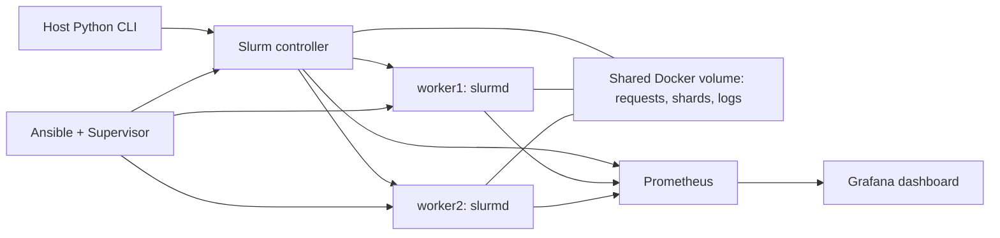

# Research Compute Lab

A local Slurm research-compute lab with one controller, two Linux worker containers, deterministic job arrays, Ansible configuration, shared storage, Prometheus alerts, and Grafana.

Built to practice scheduler operations and validate reproducible workloads. The Monte Carlo pi workload is a small infrastructure fixture, not a trading model.

## Start

Requires Docker Engine with Compose v2 and Python 3.10+ on the host. On Windows, use Docker Desktop's Linux engine with WSL 2. Allow roughly 4 GB of free memory and disk space for the images. Initial image downloads take several minutes.

```bash
git clone https://github.com/ritulrashi/research-compute-lab.git
cd research-compute-lab
python lab.py up
python lab.py status
python lab.py submit
```

Open [Grafana](http://localhost:13000/d/research-lab) and [Prometheus](http://localhost:19090). Both bind only to the local loopback interface. Grafana provides anonymous viewer access for this local lab.

```bash
python -m unittest discover -s tests -v
python verify_lab.py
python lab.py down
```

The acceptance script drains and restores worker1, then stops and restarts worker2. Run it only when no other lab jobs are needed. It records commands and results in `runs/acceptance.json`. Stopping the lab preserves named volumes.

## Architecture



MUNGE authenticates scheduler traffic using a key generated locally into an isolated named volume. The key is not in the repository. Each compute container has an outer Docker limit of two CPU equivalents and 1 GiB RAM. Slurm schedules two logical CPUs and 512 MiB of requested memory per worker.

## What happens when you submit

1. The controller creates a unique request with workload parameters and source hash.
2. Slurm submits an array with one task per shard, one requested CPU and 64 MiB memory per task.
3. Workers derive stable random streams from the seed and shard ID, then atomically write separate JSON artifacts to the shared volume.
4. The collector rejects missing, extra, duplicate, inconsistent, or invalid shard results.
5. The controller compares the combined checksum against a serial reference and records job ID, worker hostnames and runtime.

The same seed, sample count, shard count and compatible Python runtime reproduce the result. Changing shard count changes the streams. This process validates correctness; it does not assert that distribution is faster for a small workload.

Submit a larger workload:

```bash
python lab.py submit --samples 10000000 --shards 16
```

Jobs have a two-minute task time limit. Array output and manifests live under `/shared/runs/<run-id>` inside the cluster.

## Operations and evidence

- [Runbook](docs/RUNBOOK.md): queue inspection, drain/resume, logs and recovery.
- [Validation report](docs/VALIDATION.md): actual environment and acceptance results.
- [Baseline](docs/BASELINE_VALIDATION.md): initial single-machine correctness checks.
- `verify_lab.py`: two-worker execution, repeat configuration with zero changes, array correctness, dashboard/metrics checks, pending-job behavior and worker-outage alert.
- `tests/`: deterministic workload tests and collector rejection tests.
- `monitoring/`: provisioned dashboard, scraper configuration and alert rules.
- `infra/`: declarative node configuration and supervised daemon startup.

## Scope and tradeoffs

This is a functional container cluster on one machine, with a shared kernel and Docker volume. It is not evidence of physical cluster scaling, NFS administration, cloud deployment or production HPC operations.

Slurm cgroups are explicitly disabled in this unprivileged lab. Requested CPU/memory resources affect scheduling; per-job limits are not enforced. Docker enforces outer container limits. Process tracking uses Linux process tracking. No privileged containers or Docker socket mounts are required.

Storage is a shared Docker volume, not a network filesystem. The controller persists scheduler state and a file completion log; no slurmdbd/accounting database or high availability is configured. Prometheus displays alerts; no external notification delivery is configured. There is no automatic checkpoint/retry of interrupted research tasks.

Future extensions: Linux VMs with systemd and cgroup enforcement, real NFS, accounting database, workload checkpoint/retry, and budget-approved cloud provisioning. They are outside the completed local lab.

## References

- [Slurm administration](https://slurm.schedmd.com/quickstart_admin.html)
- [Slurm arrays and submission](https://slurm.schedmd.com/sbatch.html)
- [Slurm cgroup configuration](https://slurm.schedmd.com/cgroup.conf.html)
- [Compose startup dependencies](https://docs.docker.com/compose/how-tos/startup-order/)
- [Ansible documentation](https://docs.ansible.com/ansible-core/2.20/index.html)

MIT license for this project's source. Container dependencies retain their respective licenses.
